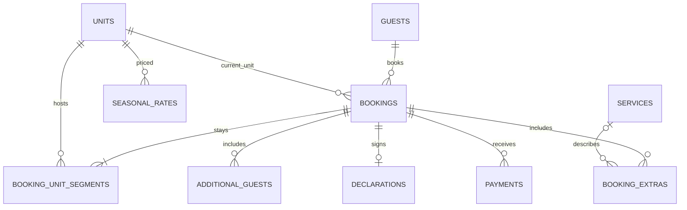

# Eva Camp — architecture and database foundation

## Intended architecture
A Windows Electron main process owns SQLite, the filesystem, security and printing. A context-isolated preload exposes narrow, validated IPC operations to a React renderer. Never expose SQL, Node or filesystem APIs to the renderer. Store the database and private attachments under Electron's userData directory, never in the installation folder. The renderer uses localized strings and switches direction with the active language. No data leaves the computer; a user-selected backup location is optional.

SQLite connections must enable foreign_keys, WAL and a busy timeout. A migration runner must execute migrations atomically and refuse unknown newer schema versions. Writes affecting booking, payment, audit and numbering must use one transaction. Use integer piasters for all amounts; display EGP divided by 100. Dates are ISO 8601 locally and displayed dd/mm/yyyy; booking intervals are [arrival, departure), permitting a same-day changeover.

The migration contains lookup and calendar indexes, soft-delete columns, overlap triggers for active bookings and a view that computes paid and outstanding amounts. Negative payments represent refunds. An encrypted ID column and separate keyed lookup column reserve the data model for exact ID matching. Cryptography, key lifecycle, PIN handling and access control are **not yet implemented**. No real guest data should be stored until those have been implemented and reviewed.

## Print reference
The attached image is a reference for header, wordmark, bilingual labels, section rules, field lines, title bar and A4 layout. The latest request specifies three companion lines; overflow for additional guests needs a separate continuation page, while the main page remains one A4 sheet. The image supplied is not a standalone logo. The runtime should use `assets/logo.png` if supplied and text fallback if absent. Arabic shaping and bidi must be tested in Chromium with bundled fonts.

## Implementation order and verification gates
1. Finish migration integration and Drizzle schema parity, migration runner, application shell and packaging dependencies. Verify fresh install and upgrade, integrity check and startup.
2. Guest, unit and booking flows: duplicate detection, autocomplete, overlap-safe moves, accessibility and calendar; test persistence and concurrent conflict cases.
3. Payment/refund transactions and receipt numbering, registration and receipt templates, and daily closing; print actual A4 samples including Arabic, long strings and blank mode.
4. Reports, import/export, backup/restore and security: crash recovery, encrypted-field search, key management, restore validation and audit.
5. Localization, performance, full automated end-to-end coverage, CI, signed or clearly identified Windows installer and portable release; test on a clean Windows 10/11 machine and a real printer.

## Unresolved engineering requirements
- Backup consistency must use SQLite's online backup API or VACUUM INTO, not a copy of a live WAL database. Test restoration and attachment completeness before pruning previous backups.
- Windows DPAPI-backed key storage and backup/restore key recovery must be designed together; a backup that cannot decrypt IDs on another PC is unacceptable. A user-supplied recovery secret is a possible design, not implemented here.
- A reliable launch lock requires main-process enforcement, password-hardening and lockout/recovery behavior; merely hiding the UI is insufficient.
- Today and monthly revenue must be defined separately from receipts, refunds and accrual; avoid silently conflating them.
- Capacity, date validity for all date-bearing tables, preventing use of deleted/maintenance units, seasonal-rate overlap, invoice snapshots, deletion/undo semantics and atomic auditing still require domain implementation and tests.
- The schema is a starting point, not a complete implementation, and must be reconciled with the eventual Drizzle schema before production.

## Schema 2: checked-in transfers

`booking_unit_segments` stores half-open `[start_date, end_date)` room intervals. `bookings.unit_id` is the latest assigned unit. A transfer shortens the previous interval, inserts its successor, updates the current unit and writes an audit entry in one transaction. Same-day changes update the latest interval and retain the change in the audit log. SQL triggers enforce active-stay conflicts, including reactivation after cancellation; extending a checked-in stay changes only its last segment. Calendar and scheduled-night queries use segments to avoid rewriting earlier room assignments. Existing bookings are backfilled atomically during migration 2. Restored schema-1 databases follow the same upgrade path.

## Schema 3: shared guest profiles and phone lookup

Bookings can explicitly reuse an existing `guest_id`. Submitted guest field values are ignored during reuse so choosing a returning guest cannot silently change its profile or encrypted identity. New profiles with an exact normalized phone match require explicit shared-phone acknowledgement; this is audited without the phone value. Name suggestions are prefix searches, with a 20-result limit. Guest history uses the guest/date index with 50-row pages. The schema upgrade backfills Western, Arabic and Persian digits and canonicalizes Egyptian mobile prefixes, preserving the original display number. Phone and name indexes contain personal information and remain unencrypted, as do the existing name and phone fields. Exact encrypted-ID lookup remains unimplemented. Profile edits are shared across bookings; historical profile snapshots are not implemented.
